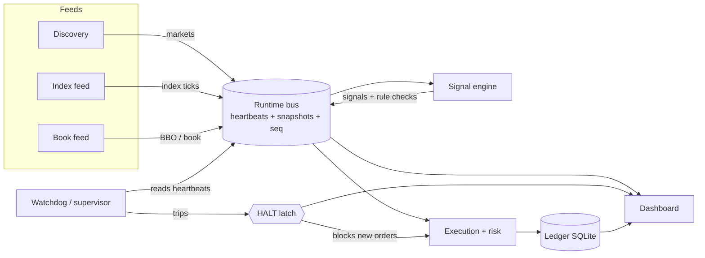

# Architecture: fail-closed paper (and later live) trading

This system is built for a future in which a mistake can cost real money.
The rule is simple: **if anything looks wrong, stop. Do not invent a workaround.
Do not skip the bad tick. Do not keep trading and hope it recovers.**

A halt **latches**. It stays on until a person acknowledges it and restarts.
The supervisor will not silently resume trading.

Paper mode uses the same interlocks as live mode would. The only difference
today is that the execution component never sends a real order.

## Components (separate processes)

Each component is its own process. One of them can hang or crash without
the others freezing — but the **watchdog** will still halt the whole trading
path if that component’s heartbeat goes stale.

| Process | Job |
|---|---|
| **Discovery / rollover** | Find the current and next Up/Down window for each asset × horizon. Compute expected slugs ahead of time. Never treat an ended window as current. |
| **Index feed** | Poll the official CF Benchmarks index via the public Asset Prices API, about once a second. |
| **Book / market-data feed** | Poll BBO, and the book endpoint when BBO 404s, for live windows. |
| **Strategy / signal engine** | Apply every rule in the active strategy file, record pass/fail for each rule, and publish signals. It does not place orders. |
| **Risk manager / interlock** | Daily profit target and loss limit, kill switch, exposure caps — and it **refuses every new order** if the global halt latch is set. |
| **Execution** | Paper fills only, today. Checks the halt latch **before every order**. In a future live mode it would also cancel resting orders on halt. Open paper positions may still settle so P&L is not left hanging. |
| **State / ledger** | SQLite + CSV audit of orders, settlements, equity. Source of truth for cash and positions. |
| **Supervisor / watchdog** | Starts the processes, reads heartbeats, checks clocks and freshness, trips the halt latch. If a trading process exits, it trips the latch and **does not restart that process** until a person resets the halt. The dashboard stays up so you can see why. |
| **Dashboard API / UI** | Read-only. Serves the terminal screen and the Rules page. Status is derived from **data age and the halt latch**, not from “is the process still running?” |

## How they communicate

Components do not call each other in-process. They share a small **runtime bus**
under `data/runtime/`:

- `heartbeats/<component>.json` — atomic heartbeat: wall clock, monotonic clock, sequence number, and a short status.
- `snapshots/<component>.json` — the component’s latest data (markets, indexes, books, signals, execution/P&L).
- `events.jsonl` — append-only event and halt log.
- `HALT.json` — the global latch (absent = not halted).

Every message has a **sequence number** that only increases. The watchdog and
dashboard ignore a file that goes backwards.

Heartbeats are due about once a second. Freshness limits are tighter for 5‑minute
markets than for 1‑hour markets (see thresholds below).



## Interlock rules

1. **Global halt latch.** Any component, or the watchdog, can trip `HALT.json`.
   The first reason is kept. Later trips are logged but do not replace it.
   Execution reads the latch before every new order. If it is set: no new order.
   In live mode, also cancel resting orders. Clearing the latch is a **manual**
   step (`scripts/reset_halt.sh --yes`). There is no auto-clear.

2. **Heartbeats and freshness.** If a required component’s heartbeat is older
   than its threshold, the watchdog trips the latch.

   | Component | Stale after | Notes |
   |---|---|---|
   | Index feed | 5s | 5m windows are unforgiving |
   | Book feed | 8s | Includes BBO-404 book fallback |
   | Discovery | 25s | May do several API calls; HeartbeatKeeper must still beat during a cycle. Threshold is not raised for host stalls. |
   | Engine | 8s | |
   | Execution | 8s | |
   | Watchdog | 8s (dashboard flag) | If the watchdog itself goes quiet, the dashboard shows HALTED/STALE even if the file has not been written yet |

3. **Missing current window.** For each asset × horizon, there must be a live
   window once we are past window-open plus a short grace (20s for 5m, 30s for
   15m, 45s for 1h). After grace, a missing or still-ended slot trips the latch.
   The grace exists only because the venue’s BBO can 404 for a short time after
   a new window opens; it is not permission to trade on a stale slot.

4. **Clock check.** Each heartbeat stores wall time and `monotonic` time.
   If wall time and monotonic time drift apart by more than 2 seconds, or a
   component’s wall clock differs from the watchdog by more than 3 seconds,
   the latch trips (`clock_skew`).

4a. **Host / scheduler stall.** The supervisor measures its own loop gap
   (`observe_scheduler`). The loop is supposed to wake about every 1s. If
   monotonic time jumped by 5s or more, or wall time jumped 5s ahead of
   monotonic time, the supervisor itself was not scheduled (host pause, CPU
   steal, wedged disk). Every in-process HeartbeatKeeper in this guest froze
   with it, so a `stale_heartbeat` trip on that resumed tick would blame the
   wrong component. The supervisor logs `host_stall`, resets the watchdog
   generation, and skips that inspect. If a worker is still stale on the next
   timely tick, the latch trips as usual. Thresholds are unchanged.

5. **Exceptions and crashes.** An uncaught exception trips the latch and the
   process exits. The supervisor does **not** auto-restart trading processes
   while the latch is set. That is “fail closed,” not “fail and try again.”

6. **State mismatch.** If execution’s idea of open positions does not match the
   ledger, or a sequence number goes backwards, trip the latch.

7. **Idempotent order IDs.** Every paper (and later live) order has a stable ID
   derived from market slug, side, window start, and a client sequence. A retry
   must not double-fill.

8. **Daily limits and kill switch.** +5% / −10% daily rules and `data/KILL`
   still stop new entries. Those are ordinary risk stops. The halt latch is
   separate and stronger: it means the **system** is not trusted until a person
   says otherwise.

9. **Dashboard status.** “TRADING” only if the latch is clear **and** all
   required heartbeats are fresh. A live PID with 8‑minute-old data is
   **STALE / HALTED**, not “Running.”

## Failure modes

| What goes wrong | What happens |
|---|---|
| Index, book, or discovery heartbeat goes stale | Watchdog trips halt. No new orders. Dashboard shows HALTED and the stale component in red. |
| HTTP hang inside discovery (this is what froze the old monolith for 12 minutes) | HeartbeatKeeper on a side thread keeps `wall_ts` fresh (urllib releases the GIL). If the keeper itself cannot run, the watchdog still trips when the supervisor is scheduled. |
| Host / guest stall (all user space, including the supervisor and every keeper, frozen while clocks keep ticking) | Supervisor sees its own loop gap ≥ 5s, logs `host_stall`, skips that inspect. A worker still stale on the next timely tick still halts. |
| BBO 404 on a new 5m window | Book feed uses the book endpoint. If there is still no live window after the grace period, halt. |
| Engine or execution throws | Latch trips, that process exits, it is not auto-restarted, no new orders. |
| Clock skew / sudden wall-clock jump | Latch trips with `clock_skew`. |
| Ledger vs memory mismatch, sequence going backwards | Latch trips with `state_mismatch`. |
| Daily profit target or loss limit | New entries stop; this is a risk stop, not a system halt. Opens may settle. |
| `data/KILL` appears | New entries stop (kill switch). |
| Dashboard or tunnel dies | Trading interlocks are unchanged. Fix the dashboard separately. |
| Someone deletes a heartbeat file | Treated as stale → halt. |
| Halt already set and another fault occurs | Logged; original halt reason is kept. Still halted. |
| Supervisor restarts after a crash | Sees `HALT.json`, does **not** re-enable trading, brings up dashboard + watchdog only until `reset_halt.sh --yes`. |

## Restart after a halt

1. Read the dashboard halt banner, or `data/runtime/HALT.json` and `data/runtime/events.jsonl`, and understand the reason.
2. Fix the cause (network, clock, missing window, bug).
3. `scripts/reset_halt.sh --yes` — this is the only supported clear.
4. `scripts/run_system.sh` if the supervisor is not already waiting to bring trading processes back after a reset. If it is still running, it will start the trading processes only after the latch is clear.
5. Confirm the top bar says **TRADING**, heartbeats are under their thresholds, and the market grid shows the *current* windows, not ended ones.

Do not delete `HALT.json` by hand unless the reset script cannot run; if you do, still restart the supervisor so every process sees a consistent state.

## What went wrong on 24 Nov 2026 (the 8‑minute stale screen)

The old bot was a **single process**. Discovery, index polls, book polls, and
`live_state.json` all shared one loop. Near a rollover, discovery tried many
slug lookups with up to 4 retries and a 15s HTTP timeout each. At 12:45:53 ET
it blocked inside discovery. The next log line was 12:57:52 ET — **719 seconds
later**. No new `live_state.json` was written (last snapshot 12:45:06 ET). The
process was still alive, so the dashboard said Running (or “Running (stale)”).
Window countdowns used the stale snapshot’s `window_end`, which had already
passed, so the cards sat on “waiting for next window” and never rolled.

That is exactly the class of failure this architecture is meant to stop:
one stuck API call must not look like a healthy trading system.

## Paper vs live

Today every component runs in **paper mode**. Execution will refuse to start
if `config.yaml` says `live`. A future live mode would use the same latch,
heartbeats, and order-ID rules, plus cancel-on-halt for resting orders, and
would still require a manual ack after any halt.

## Deployment (DigitalOcean, 24 Nov 2026)

The paper system runs on a single DigitalOcean droplet. The box no longer
runs the trading supervisor or the public tunnel. Free tunnels are not used
in production.

| | |
|---|---|
| Droplet name | `polymarket-bot` |
| Droplet ID | `623064882` |
| Public IPv4 | `104.236.203.158` |
| Region | `nyc3` (New York 3) |
| Size | `s-1vcpu-1gb-intel` (1 vCPU, 1 GB RAM, 25 GB disk, **$7/mo**, $0.01042/hr) |
| Image | Ubuntu 24.04 LTS (`ubuntu-24-04-x64`) |
| Monitoring | on (DigitalOcean agent; no extra paid product) |
| Backups | off |
| Firewall | `polymarket-bot-fw` (`6391a346-451b-481e-b458-d19748d37823`): inbound TCP 22/80/443 only; outbound TCP/UDP/ICMP |
| Timezone | `America/New_York` (systemd-timesyncd) |
| App dir | `/opt/polymarket-bot` |
| SSH key | `/workspace/polymarket-bot/deploy/do_ed25519` (registered on the account as `polymarket-bot-deploy`, key id `61144609`) |

SSH:

```bash
ssh -i /workspace/polymarket-bot/deploy/do_ed25519 -o IdentitiesOnly=yes root@104.236.203.158
```

Connection facts also live in `deploy/droplet.env` (gitignored).

**systemd units** (`Restart=on-failure`; none of them touch `HALT.json`):

| Unit | Role |
|---|---|
| `polymarket-bot-supervisor.service` | `python -m polymarket_bot.runtime.supervisor` — fail-closed trading workers. A systemd restart while halted does **not** clear the latch; the supervisor sees `HALT.json` and will not start trading. Clear only with `scripts/reset_halt.sh --yes` on the droplet. |
| `polymarket-bot-dashboard.service` | uvicorn on `127.0.0.1:8787` |
| `caddy.service` | HTTPS reverse proxy with automatic Let's Encrypt. `flush_interval -1` so SSE ticks are not buffered. |

Caddy hostname: `104-236-203-158.sslip.io`. Permanent dashboard URL (same token as before):

`https://104-236-203-158.sslip.io/?token=…`

(The full URL with token is in `data/dashboard_url.txt` and `data/last_sent_dashboard_url.txt` on the box.)

**Box-side reporting.** `scripts/pull_from_droplet.sh` rsyncs `/opt/polymarket-bot/data/` back to the box `data/` directory so `daily_report.py`, `dashboard_data.py`, and the Page refresh keep working. It uses `deploy/droplet.env`. It does not overwrite `dashboard_url.txt` or `last_sent_dashboard_url.txt`. Run it before generating a daily report.

**Fragile points.** The hostname is IP-based (`sslip.io`); a droplet IP change would need a new cert and URL. The $7/mo 1 GB droplet has a 1 GB local swapfile so pip/tests/workers do not OOM — if swap is used heavily, heartbeats can lag. Let's Encrypt renewal is automatic via Caddy but needs 80/443 to stay open. `sslip.io` DNS is a third-party free service. This box sinkholes `*.sslip.io` to `198.18.0.1`; from the box, use `curl --resolve 104-236-203-158.sslip.io:443:104.236.203.158`. Paper only; no live keys on the droplet.

## Dashboard and operator controls (redesign, 24 Nov 2026)

**Data flow.** `web/app.py` runs one background `StateHub`. Once a second it composes bus state (`runtime/view.compose`), appends index prices and per-market quotes to ring buffers (index 2h, markets 2h; persisted to `data/runtime/dash_history.json` every 30s), and computes ledger analytics with `polymarket_bot/analytics.py` from a read-only sqlite connection (fills only: `status IN ('open','settled')`). SSE `/api/stream` sends a snapshot on connect, a tick every second (KPIs, risk state, grid with verdicts, controls, new events only) and a `ledger` message when the ledger version changes. `/api/history` serves chart history on page load. Charts use uPlot 1.6.32 vendored in `web/vendor/` (served without the token because it holds only the public library; every data route still needs the token).

**Timestamps.** The equity table has mixed naive-local and ISO-with-offset strings; text `ORDER BY ts` misorders them. `analytics.parse_ts` treats naive values as America/New_York, and every reader sorts on the parsed instant. Writers now store tz-aware ISO (`execution` equity rows, engine evaluations). The equity curve is built from settlements (one step per settled bet at its window end, or the flatten time).

**Verdicts.** Rule checks carry numbers (`rules.measure`). `verdict.decide` turns both sides' checks plus portfolio gates (HALT, operator pause, enabled asset/horizon, daily target/limit, holding, position cap, zero stake) into BUY UP / BUY DOWN / NO TRADE / HOLD / WAIT / OFF with a one-line reason and a stake preview from `sizing.size_order`. The engine publishes these on each grid row, emits a `decision` event when a market's verdict or reason category changes (throttled to 30s per market), and appends evaluations to `data/evaluations.csv` on change or every 30s per side. Before this, the runtime engine never wrote evaluations, which is why the CSV stopped at 1:05 PM ET when the old monolith was retired.

**Execution gating.** Execution checks kill switch, operator pause, daily target/limit and asset/horizon enablement before sizing, so blocked entries are not written to the ledger (the old loop wrote a `rejected` row every second while the target was hit: about 23,000 rows). It logs one `blocked` event per market/side and backs off 30s after a real reject.

**Controls.** `runtime/controls.py` whitelists: entries_paused, min_edge_after_fees (1–30%), max_per_bet_usd ($1–100), kelly_fraction (0–0.5), assets, horizons, no_trade_final_seconds (5–900s), daily_profit_target_pct (0.5–25%), daily_loss_limit_pct (1–20%). Anything else, including mode or keys, is rejected, and a hand-edited file is re-validated on read. `POST /api/controls` and `POST /api/controls/flatten` (typed `FLATTEN`) need the token in the `X-Dashboard-Token` header. They write versioned `data/runtime/controls.json` and log a `control` event. Engine and execution poll it, rebuild their config overlay (`effective_config`, which always forces `mode: paper`), log "applied vN", and report `controls_version` in their heartbeats; the UI shows ✓ when both match. Flatten closes open paper positions at the bid minus fee and pauses entries. HALT reset is not a control: `scripts/reset_halt.sh --yes` on the CLI only.

**Events.** `bus.event` is a single `O_APPEND` write; `recent_events` reads only the file tail; the file rotates to `events.jsonl.1` above 20 MB.

**Screenshots.** `scripts/screenshot_dashboard.py URL OUT.png --resolve HOST=IP` drives headless Chrome over CDP (SSE never finishes loading, so plain `--screenshot` captures too early) and prints console errors plus element counts.

## Extension phase (24 Nov 2026, evening): health, profit lock, strategies, integrations, archiving

```
                 ┌───────────── supervisor (systemd: polymarket-bot-supervisor) ─────────────┐
                 │ watchdog · HealthMonitor thread · archive job thread · aux restarter       │
                 │   critical FAILED ×2 ──► HALT latch (data/runtime/HALT.json)               │
                 └──┬──────────┬──────────┬──────────┬───────────┬──────────────┬────────────┘
             discovery   index_feed   book_feed    engine      execution     strategy_lab (non-critical)
                 │           │           │   signals+strategy   │ main ledger    │ 4 shadow ledgers
                 └───────────┴───── file bus: data/runtime/{heartbeats,snapshots,events.jsonl} ──────┘
                                                   │
            dashboard (systemd: polymarket-bot-dashboard, uvicorn 127.0.0.1:8787) ◄── Caddy :443 (TLS)
            pages: / · /health · /strategies · /patterns · /integrations · /archives · /rules   API: /api/* · /healthz · /metrics
```

### Health and critical components

`src/polymarket_bot/health.py` defines probes. The supervisor runs them in a background thread (`HealthMonitor`), each on its own schedule, and publishes the merged list to `snapshots/health.json` every second. Each item has a status (`OK` / `DEGRADED` / `FAILED`), a rule, a threshold, a value, a last heartbeat, and a *critical* flag.

| Component | Class | FAILED when |
|---|---|---|
| discovery, index_feed, book_feed, engine, execution, supervisor_watchdog | CRITICAL | heartbeat stale/missing (watchdog latches HALT, as before) |
| supervisor | CRITICAL | health snapshot older than 10 s (computed by the dashboard). Execution also halts itself if the watchdog beat is older than 30 s |
| disk | CRITICAL | free < 1 GB or < 5 % (**halts before the disk fills**); DEGRADED < 3 GB / 15 % |
| memory_swap | CRITICAL | MemAvailable < 3 % **and** swap > 90 % used |
| ntp_clock | CRITICAL | \|offset\| > 1 s (`timedatectl timesync-status`); DEGRADED if > 0.25 s, unsynced or unknown |
| sqlite_integrity | CRITICAL | `PRAGMA quick_check` ≠ ok, or the file is not a database (every 15 min; locked = DEGRADED) |
| ledger | CRITICAL | ledger unreadable; DEGRADED if no equity write for 30 s while execution trades |
| strategy_lab, caddy_tls, dashboard, archive_job, sync_acks, llm_reviewer, alerts | non-critical | shown and alerted, **never halt** |

A critical system probe must fail on **two consecutive checks** before it latches HALT, so a single glitch is not enough. The latch reason is `health_critical` and the component is the probe name. Reset stays CLI-only.

### Continuous accounting, session risk window, escalating profit-lock cooldowns & rolling HWM guard

- **Continuous lifetime ledger**: `analytics.ledger_bundle` and `risk.restore_state` compute equity, cash, net P&L, staked, win rate, profit factor, drawdown, and the equity curve continuously across all days. Today's P&L and bets are reported separately (`kpis.today`), and the UI equity chart supports `24h | 7d | 30d | ALL`.
- **Configurable risk window (`calendar_day` default / `rolling_24h` option)**: `risk.window_start_ts` defines the active session start (midnight ET by default). `starting_day_equity` equals `starting_cash + prior_realized_pnl` at window start, so both the profit-lock target and −10 % session loss limit scale with actual account equity and reset at the session boundary.
- `src/polymarket_bot/profit_lock.py` is a pure function of the session's settlements plus `now` (`RiskManager.apply_daily_halts` refreshes the window continuously). A process restart reproduces the same phase; there is no side file that can go stale. Settlements that share a timestamp are applied together.
  - **TRADING**: full size until session realized P&L reaches the target (fixed `daily_profit_target_pct` or 7-day adaptive target clamped to [3 %, 10 %]).
  - **LOCKED** (dashboard **LOCKED-HALF**): floor = `segment_base + lock_ratio × (peak − segment_base)` (default 70 %), ratchets up only; sizing uses `locked_size_mult × Kelly` (default 0.5).
  - **COOLDOWN**: floor breach *n* (for *n* < `max_breaches`, default 3) pauses new entries for `cooldown_minutes[n-1]` minutes (default 60, then 120). After expiry the bot resumes LOCKED-HALF with the floor re-armed from current session P&L and peak tracking restarted from that baseline.
  - **STOPPED_SESSION / STOPPED_LOSS / STOPPED_TARGET**: the `max_breaches`-th floor breach, the session −10 % loss limit, or (fixed mode) the target. New entries pause for the rest of the session; open positions settle normally. Everything resets at the session boundary.
- **Rolling 24h HWM guard** (`risk.trailing_hwm_state`): if current equity is `rolling_guard_pct` (default 10 %) below the high-water mark inside the trailing `rolling_guard_hours` (default 24h, spanning midnight), execution trips a fail-closed `rolling_drawdown` HALT. Only `scripts/reset_halt.sh --yes` clears it. A recovered historical dip does not trip.

### Bayesian pattern learning (`src/polymarket_bot/patterns.py`)

- Every evaluation and settled trade extracts context features (`asset`, `horizon`, `hour_et`, `hour_bucket`, `weekday`, `minutes_left`, `distance_sigma`, `vol_regime`, `model_prob`, `ask`, `edge`, `spread`, `depth`, `strategy`, `outcome`, `pnl_usd`) into `data/patterns/evaluations.jsonl`, `data/patterns/store.json`, and SQLite `trade_patterns`.
- `PatternStore` updates hierarchical Beta-Binomial win-rate and shrunk ROI/EV posteriors online after every settlement (idempotent on `order_id`).
- Controlled via `pattern_mode` (`off | shadow | active`, default `shadow`) and `pattern_min_samples` (default 20). In `active` mode, scales Kelly within `[0.25×, 1.50×]` inside all hard caps and skips contexts with `n ≥ min_samples` and `post_ev ≤ −2 %` (`ev_ucb < 0`). Served on `/patterns` and `/api/patterns`.

The KPI strip shows the target, peak, floor and mode. The equity chart draws the target line, a stepped floor line and the peak.

### Strategies, shadow books, reviewer, gate

- `strategies.py` holds the registry. Every strategy must pass all non-edge rule checks. It can then set its own edge threshold (never below 2 %) and add filters such as min probability, ask band or late window. Parameters are clamped to `PARAM_BOUNDS`.
- `data/strategies/active.json` selects the active strategy. The engine applies it to the signals it publishes and adds `strategy` and `strategy_version`. Execution re-applies it to the engine's base checks and **skips the fill if the two disagree**, for example in the middle of a switch.
- `strategy_lab.py` runs as the `strategy_lab` process. It keeps one `PaperExecutor` per strategy, each with its own sqlite under `data/strategies/shadow/<name>/`, so sizing, risk, profit lock and settlement are identical to the main book. It writes `metrics.json` every 10 s and runs the hourly review in a thread. It is **non-critical**: the supervisor restarts it after 30 s if it exits, and it never touches the HALT latch.
- `reviewer.py` handles review. An LLM (optional) proposes a ranking, a suggested active strategy and parameter tweaks as strict JSON. Tweaks are clamped and step-limited, and apply to shadow books only. The deterministic gate decides. If the LLM call fails, the current strategy is kept and the reviewer shows DEGRADED. Every proposal, gate result, approval, rejection and switch is appended to `data/strategies/decisions.jsonl` and to the event stream.

### Integrations

`integrations.py` holds LLM keys. They are stored in `data/secrets/integrations.enc`, encrypted with Fernet under `data/secrets/master.key`. Both files are mode 0600 inside a 0700 directory. Non-secret metadata goes in `data/integrations.json`. Test calls use list-models or key-status endpoints, which bill no tokens.

### Archiving

`archive.py` is run by the supervisor every 10 min.

- **Trigger.** It fires when movable bytes, plus sqlite growth since the last snapshot, pass 300 MB (`ARCHIVE_THRESHOLD_MB`).
- **Ledger.** The live ledger is never replaced, and open or settled orders are never removed.
- **Contents of each part:**
  - CSV rows dated before today (ET), moved out of the live files under the same `flock` the writers take
  - rotated event files (the bus now keeps every rotation under `runtime/rotated/`)
  - copy-truncated logs
  - a `VACUUM INTO` snapshot of each sqlite
- **Packaging.** Everything is packed into `data/archive/part-NNNN-<start>-<end>.tar.zst`, verified with `tar -t`, and described by a manifest (per-file sha256, rows, bytes, range, plus the archive's own sha256).
- **Pruning.** It happens only after an ack with the matching sha256. Old rejected orders and equity snapshots leave the live sqlite at that point, and the tarball is deleted 3 days later (the manifest is kept under `archive/acked/`).
